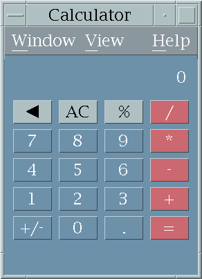
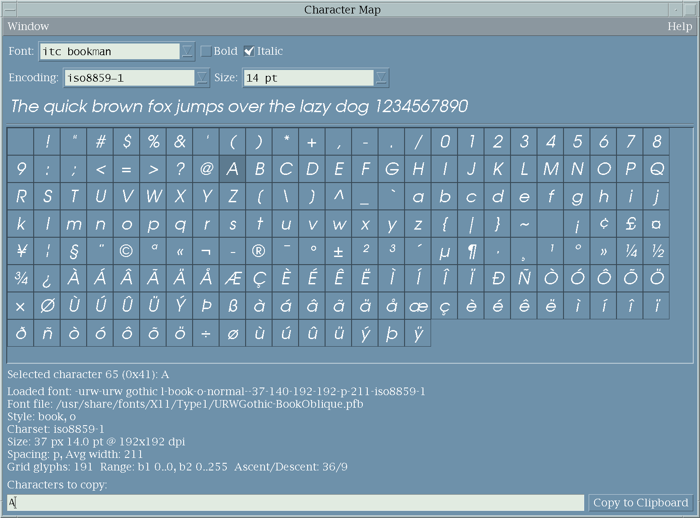
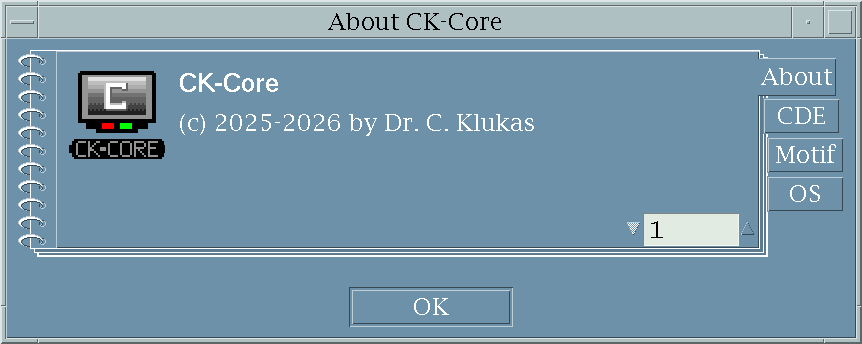
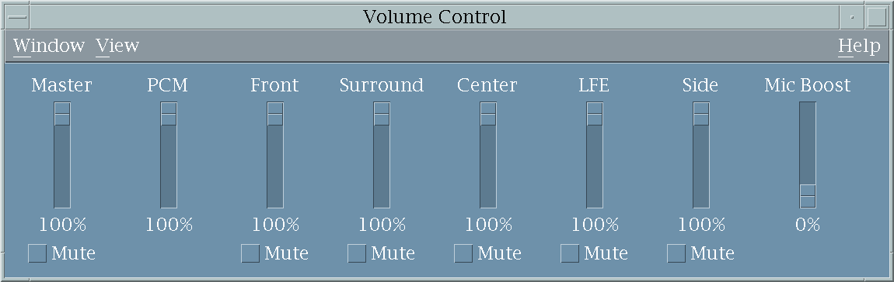
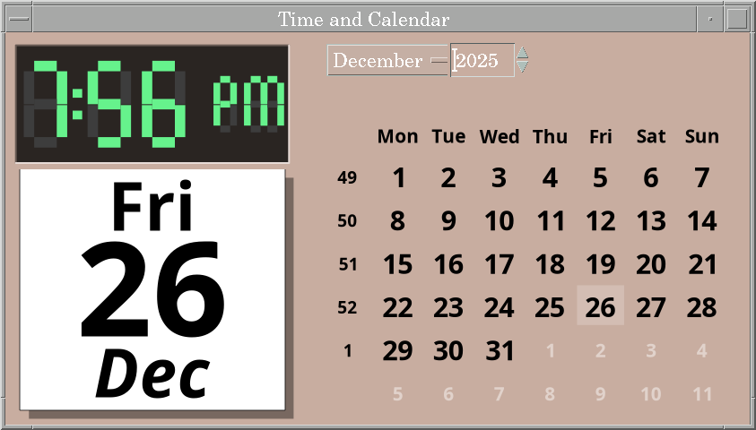
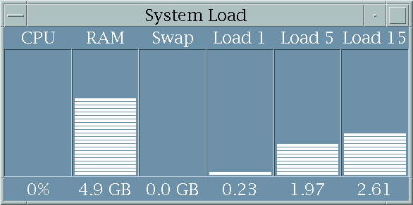
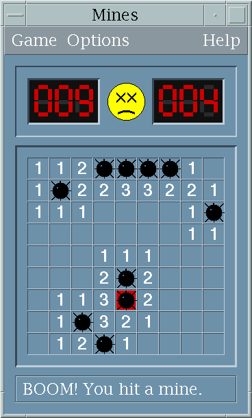
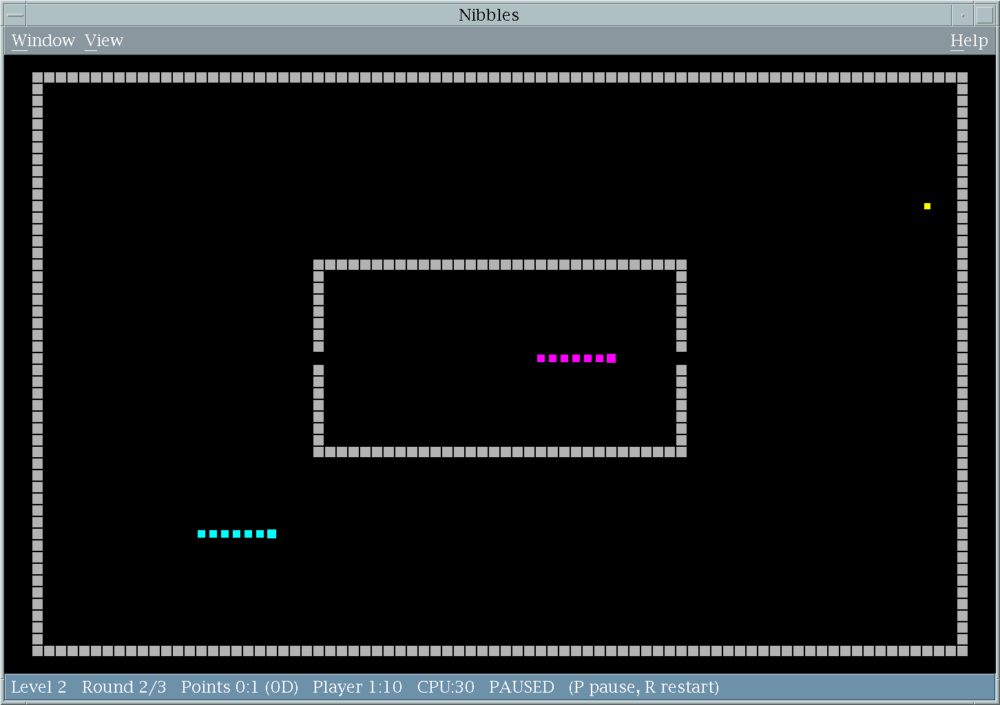

# Application catalogue

`ck-core-apps` builds **15 native Motif programs** grouped into desktop tools, live desktop companions, and games/demos. Select any binary below for its full CLI options, keyboard shortcuts, configuration paths, and session behavior.

## Desktop tools

| Application | Summary | Persistence |
| --- | --- | --- |
| [`ck-about`](tools/ck-about.md) | Tabbed CDE, Motif toolkit, and OS version inspector (`XmNotebook`). | CDE session (`geometry`, active tab) |
| [`ck-calc`](tools/ck-calc.md) | Basic immediate-execution and Scientific expression calculator with CDE palette styling and clipboard menu. | `~/.config/ck-core/ck-calc.view` + CDE session |
| [`ck-character-map`](tools/ck-character-map.md) | X11 core font and glyph browser with sample preview, font file lookup, and UTF-8 clipboard copy. | CDE session (`geometry`, font/style/size) |
| [`ck-grab`](tools/ck-grab.md) | Full-screen and active-window screenshot utility exporting PNG and XPM with cursor and frame toggles. | `~/.config/ck-core/ck-grab.{view,paths}` + CDE session |
| [`ck-mixer`](tools/ck-mixer.md) | Multi-column ALSA playback volume control with live hardware event polling and channel filtering. | `~/.config/ck-core/ck-mixer.view` + session geometry |
| [`ck-tasks`](tools/ck-tasks.md) | Multi-tab task manager covering X11 windows, `/proc` processes, init services, performance meters, and `utmp` users. | CDE session (`geometry`, active tab) |

| Calculator (`ck-calc`) | Character Map (`ck-character-map`) |
| --- | --- |
|  |  |

| About (`ck-about`) | Volume Control (`ck-mixer`) |
| --- | --- |
|  |  |

## Live desktop companions

All six companions also render [high-resolution dynamic window icons](dynamic-icons.md) sized to `dtwm`'s advertised `WM_ICON_SIZE`.

| Application | Summary | Dynamic icon mode |
| --- | --- | --- |
| [`ck-status`](companions/ck-status.md) | Workstation & laptop status console (Power/Battery, Wi-Fi/Network, Bluetooth, `org.freedesktop.Notifications` server, `StatusNotifier` tray host, and `54×48` Front Panel live gauge). | 4-quadrant Wi-Fi / Bluetooth+Alert / Battery fuel-gauge icon (`48×48` & `96×96`) |
| [`ck-clock`](companions/ck-clock.md) | Cairo-rendered digital LED and tear-off day tile that expands into an ISO-week monthly calendar. | Open-window (per minute) & minimized (per second) |
| [`ck-load`](companions/ck-load.md) | Six-column segmented meter for CPU, RAM, swap, and 1/5/15-minute load averages. | Minimized or when `dtwm` open-window icons are enabled (`1 s`) |
| [`ck-eyes`](companions/ck-eyes.md) | Pointer-tracking eyes companion with elliptical and circular geometries. | Shaped 1-bit masked icon while minimized (`50 ms`) |
| [`ck-coins`](companions/ck-coins.md) | CoinGecko USD spot-price monitor with `flock`-cached responses and `Xft` icon rendering. | Open-window & minimized (selection + 15-minute refresh) |
| [`ck-browser`](companions/ck-browser.md) | Multi-tab CEF web browser with Netscape bookmarks, theme-colored tabs, TLS status, and DevTools. | Active tab's scaled favicon (`IconPixmapHint` + mask) |

| Clock & Calendar (`ck-clock`) | System Load (`ck-load`) |
| --- | --- |
|  |  |

## Games and demos

| Application | Summary | Persistence |
| --- | --- | --- |
| [`ck-mines`](games/ck-mines.md) | Classic Minesweeper with 7-segment LEDs, safe first click, chording, `2×` scaling, and fastest-time records. | `~/.config/ck-core/ck-mines.conf` |
| [`ck-nibbles`](games/ck-nibbles.md) | One- or two-player QBasic-style snake game with CPU opponent, six cycling wall mazes, and auto-pause. | CDE session (geometry, mode, scores, round state) |
| [`ck-plasma-1`](games/ck-plasma.md) | Multi-process CPU plasma animation demo using worker pipes and live 30 FPS minimized icon frames. | CDE session (`geometry`) |

| Mines (`ck-mines`) | Nibbles (`ck-nibbles`) |
| --- | --- |
|  |  |
