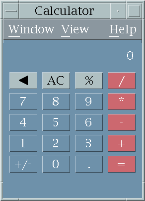
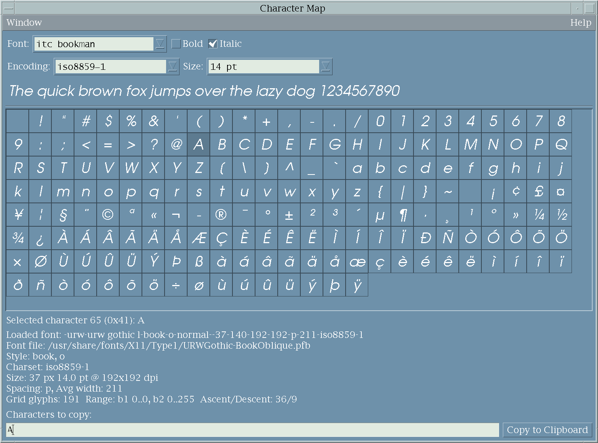
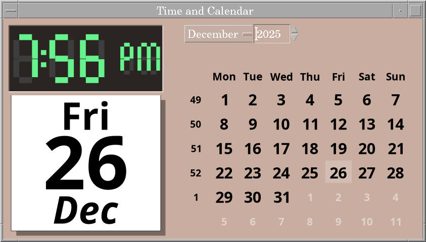
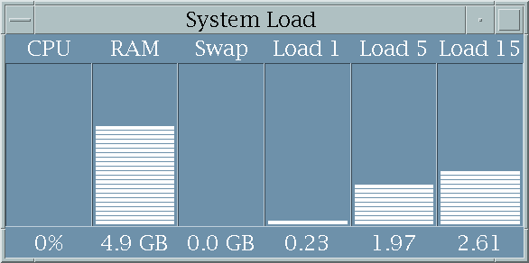
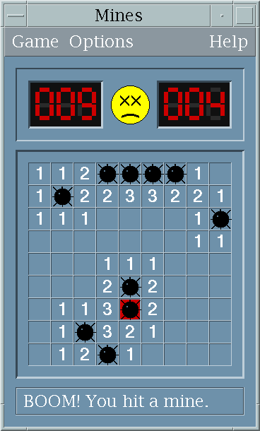
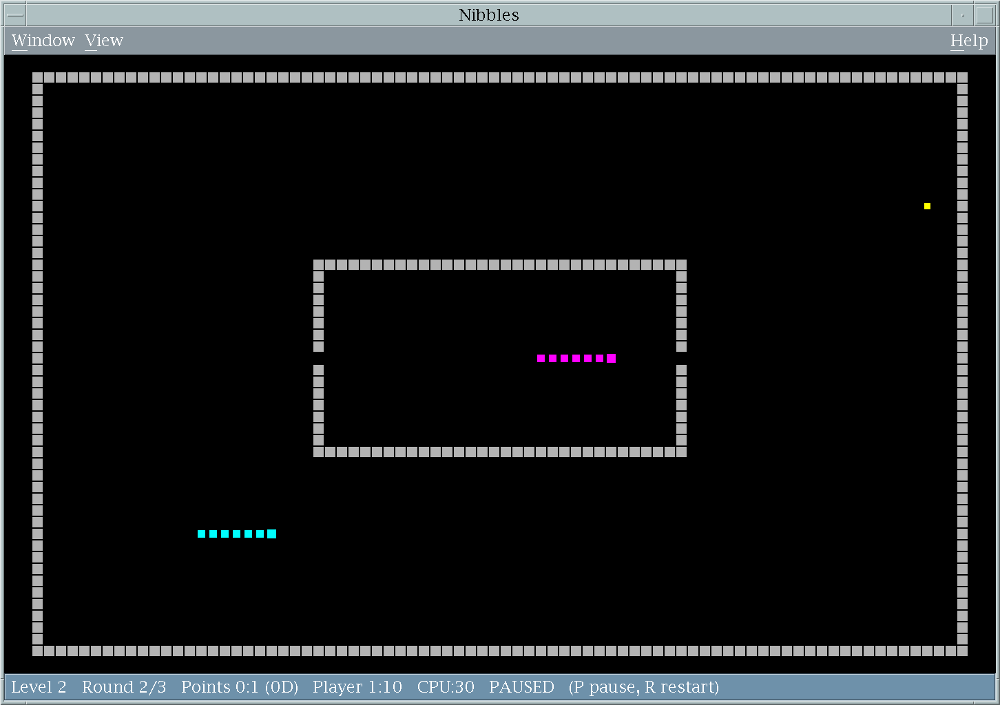

# Application catalogue

## Desktop tools

| Application | Purpose |
| --- | --- |
| `ck-about` | Reports CDE, toolkit and platform information in a native About dialog. |
| `ck-calc` | Calculator with keyboard input, session handling and multiple-window support. |
| `ck-character-map` | Font and glyph browser with copy and paste. |
| `ck-grab` | Screen capture utility with CDE-oriented controls. |
| `ck-mixer` | ALSA mixer with per-channel levels, mute state and device selection. |
| `ck-tasks` | Task manager covering processes, applications, performance, networking, services and users. |

## Live desktop companions

| Application | Purpose |
| --- | --- |
| `ck-clock` | Cairo-rendered analog clock with an extended calendar view. |
| `ck-load` | CPU, RAM, swap and 1/5/15-minute system-load monitor. |
| `ck-eyes` | Pointer-following eyes with selectable drawing style. |
| `ck-coins` | Selected cryptocurrency prices with periodic refresh. |
| `ck-browser` | Motif browser shell backed by Chromium Embedded Framework, including tabs, bookmarks and favicon integration. |

The companions also implement [high-resolution dynamic window icons](dynamic-icons.md).

## Games and demos

| Application | Purpose |
| --- | --- |
| `ck-mines` | Configurable Minesweeper-style game. |
| `ck-nibbles` | One- or two-player QBasic-style snake game. |
| `ck-plasma-1` | Multi-process animated plasma demo with a live icon rendering path. |

