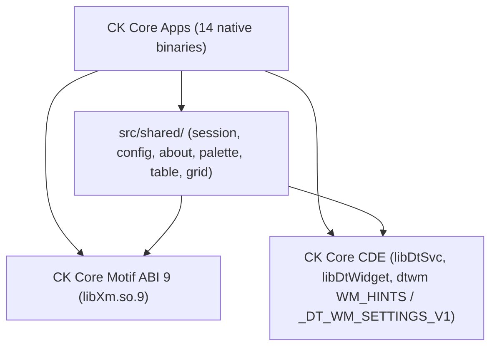

# Shared architecture and persistence

Every program in `ck-core-apps` builds directly against the matched native desktop stack—[CK Core Motif](https://cklukas.github.io/ck-core-motif/) (`libXm.so.9`, ABI 9) and [CK Core CDE](https://cklukas.github.io/ck-core-cde/) (`libDtSvc`, `libDtWidget`, `libtt`)—and shares a small set of C modules under `src/shared/` for session state, user configuration, palette inspection, About dialogs, and layout/table widgets.

For toolkit-level appearance/density resources and widget internals, see the [CK Core Motif documentation](https://cklukas.github.io/ck-core-motif/). For `dtwm` open-window icons, session management daemons, and desktop integration, see the [CK Core CDE documentation](https://cklukas.github.io/ck-core-cde/) (and [ck-core-fs-lib](https://cklukas.github.io/ck-core-fs-lib/) for the shared headless filesystem engine used by CDE).

## Shared modules (`src/shared/`)

| Module | Files | Role |
| --- | --- | --- |
| **Session utilities** | `session_utils.c`, `session_utils.h` | Parses `-session <id>`, resolves `/proc/self/exe` for `WM_COMMAND`, clamping restored geometry to screen bounds, and reads/writes key-value state via `DtSessionRestorePath` and `DtSessionSavePath`. |
| **Config utilities** | `config_utils.c`, `config_utils.h` | Reads and writes lightweight key-value preference files beneath `$XDG_CONFIG_HOME/ck-core/` (or `~/.config/ck-core/` with mode `0700`). |
| **About dialog** | `about_dialog.c`, `about_dialog.h`, `ck-core.l.pm` | Builds the standard `XmNotebook` About dialog (`App`, `CK-Core`, `CDE`, `Motif`, and `OS` via `lsb_release`) and sets XPM window icons. |
| **CDE palette reader** | `cde_palette.c`, `cde_palette.h` | Queries active CDE/Motif `ColorObj` pixel sets (`XmeGetColorObjData` and `XQueryColors`) so custom controls such as `ck-calc` buttons match the active desktop theme. |
| **Grid layout** | `gridlayout/gridlayout.c`, `gridlayout.h` | Percentage-positioned multi-row `XmForm` grid builder (`fractionBase = columns * 10`) with column-span support. |
| **Sortable & virtual tables** | `table/table_widget.c`, `ck-table/ck_table.c` | Provides both widget-per-row sortable tables (`CK_TABLE_MODE_STANDARD`) and viewport-virtualized tables (`CK_TABLE_MODE_VIRTUAL`) used by `ck-tasks` for large `/proc` process lists. |

## CDE session integration

Applications that link `session_utils.c` (`ck-about`, `ck-calc`, `ck-character-map`, `ck-grab`, `ck-tasks`, `ck-load`, `ck-eyes`, `ck-coins`, `ck-browser`, `ck-nibbles`, and `ck-plasma-1`) register a `WM_SAVE_YOURSELF` protocol callback on their top-level shell:

1. When `dtsession` checkpoints or ends a desktop session, `DtSessionSavePath` allocates a session state file under `~/.dt/sessions/` and `XSetCommand` records `<binary> -session <file>`.
2. On the next login, `dtsession` relaunches each saved command with `-session <file>`, restoring clamped screen coordinates (`x`, `y`, `w`, `h`) and tool-specific state (such as open browser tabs, active notebook pages, calculator mode, or selected cryptocurrency).

## User configuration and cache paths

Outside CDE session checkpoints, persistent user settings and caches live under standard XDG base directories:

| Path (default under `~`) | Owning tool | Stored data |
| --- | --- | --- |
| `~/.config/ck-core/ck-calc.view` | `ck-calc` | `show_thousands`, `mode` (Basic/Scientific), `trig_mode` |
| `~/.config/ck-core/ck-grab.view` | `ck-grab` | `target`, `delay`, `include_frame`, `include_cursor`, `hide_window`, `format` |
| `~/.config/ck-core/ck-grab.paths` | `ck-grab` | `last_dir` for screenshot save dialogs |
| `~/.config/ck-core/ck-mixer.view` | `ck-mixer` | `show_device_combo` and per-channel column visibility flags |
| `~/.config/ck-core/ck-mines.conf` | `ck-mines` | Difficulty preset, board size/scale, question-mark toggle, and fastest times |
| `~/.config/ck-core/bookmarks.html` | `ck-browser` | Netscape-format bookmarks with inline base64 PNG favicons |
| `~/.config/ck-core/ck-browser.homepage` | `ck-browser` | Custom browser homepage URL |
| `~/.config/ck-core/ck-browser.lastsession` | `ck-browser` | Last closed tab list for **Navigate → Restore Session** |
| `~/.cache/ck-coins/cache-<hash>.json` | `ck-coins` | `flock`-synchronized 15-minute CoinGecko price response cache |
