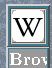
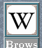
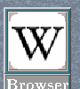
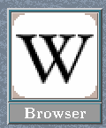

# Web Browser (`ck-browser`)

`ck-browser` (`CkBrowser` X application class, window title **Internet Web Browser**) embeds Chromium Embedded Framework (CEF) inside a native Motif/CDE shell built on `XmTabStack`. It provides multi-tab browsing, a Netscape-format bookmark manager, page-adapted tab colors, TLS status inspection, Chromium DevTools, CDE session persistence, and dynamic desktop window icons driven by the active tab's favicon.

| `32×32` icon | `48×48` icon | `64×64` icon | `96×96` icon |
| --- | --- | --- | --- |
|  |  |  |  |

## Key features

- **Tabbed Motif interface (`XmTabStack`):**
  - Each tab embeds an accelerated or software-rendered CEF view (automatically falling back to `--disable-gpu --disable-software-rasterizer --disable-gpu-compositing` when `libGL` is unavailable).
  - **Theme-colored active tabs:** An injected renderer bridge inspects `<meta name="theme-color">` and document background styles to tint the active Motif tab header to match the current site.
  - **Right-click tab menu:** Supports **Reload**, **Close Tab**, **Close Tabs to The Right**, and **Move Tab to New Window**.
- **Navigation toolbar & status bar:**
  - **Back**, **Forward**, **Reload / Stop**, **Home** (right-click **Home** to choose **Set To Blank Page** or **Use Current Page**), live **favicon** badge, and URL entry field (`https://www.wikipedia.org` initial default).
  - Three-part sunken status bar reporting link hover / load progress, **TLS security state** (`Security: None`, `Security: TLS (Valid)`, or certificate/mixed-content warnings from `CefSSLStatus`), and interactive **Zoom** controls (`25%`–`500%`).
- **Bookmarks & live cross-window sync:**
  - Stores bookmarks in standard Netscape HTML format (`bookmarks.html`) with nested folders, inline base64 PNG favicons, and `SHOW_IN_MENU` flags.
  - Includes **Add Page...** and a full **Bookmark Manager** (folder creation/renaming/deletion with bookmark migration, editing, and **Show Bookmarks** HTML view).
  - Polls `bookmarks.html` modification time once per second so changes made in one browser window appear automatically in all other open windows.
- **Context menu & Developer Tools:**
  - Intercepts **Open link in new tab**, **Open link in new window**, and **Inspect / Developer Tools** (opening a `1100×800` Motif shell hosting `CefBrowserHost::ShowDevTools`).
- **Dynamic favicon window icon:**
  - Queries `WM_ICON_SIZE`, caches downloaded favicons (up to 500 entries, 6-hour TTL), and publishes a scaled pixmap plus 1-bit alpha mask (`IconPixmapHint | IconMaskHint`) whenever the active tab or its site icon changes—both while open and while minimized.

## Keyboard shortcuts

| Shortcut | Action |
| --- | --- |
| `Ctrl+N` | **File → New Window** |
| `Ctrl+T` | **File → New Tab** |
| `Ctrl+W` | **File → Close Tab** |
| `Ctrl+O` | **File → Open File...** (`file://` picker) |
| `Alt+F4` | **File → Exit** |
| `Alt+Left` / `Alt+Right` | **Navigate → Go Back / Go Forward** |
| `Ctrl+R` | **Navigate → Reload Page** |
| `Ctrl+L` | **Navigate → Open URL** (focus and select address bar) |
| `Ctrl++` / `Ctrl+-` / `Ctrl+0` | **View → Zoom In / Zoom Out / Reset Zoom** |
| `Ctrl+1` .. `Ctrl+9` | Open the first nine pinned **Bookmarks** menu favorites |

## Building CEF and launching `ck-browser`

Because the binary CEF distribution is large, it is fetched on demand outside Git before building `ck-browser`:

```sh
./download_cef.sh          # downloads latest stable linux64 or linuxarm64 CEF into third_party/cef/
make -j6 ck-browser \
  MOTIF_PREFIX=/opt/ck-core-motif \
  CDE_PREFIX=/opt/ck-core-cde \
  CDE_SRC_INC=/path/to/ck-core-cde/cde/include
```

### Command-line options

```sh
ck-browser [-session <id>] [--ck-open-url=<url>] [--ck-cache-suffix=<suffix>] [Xt options...]
```

| Flag | Purpose |
| --- | --- |
| `-session <id>` | Restores CDE session window geometry, active tab index, and up to 100 open tab URLs. |
| `--ck-open-url=<url>` | Opens the specified URL on startup (used automatically when moving a tab or link to a new window). |
| `--ck-cache-suffix=<suffix>` | Appends `-<suffix>` to CEF's cache path so concurrent multi-window browser processes do not contend on Chromium's cache lock. |

## Configuration and runtime files

- `$XDG_CONFIG_HOME/ck-core/bookmarks.html` (default `~/.config/ck-core/bookmarks.html`): Netscape bookmark store with embedded favicons.
- `$XDG_CONFIG_HOME/ck-core/ck-browser.homepage`: Custom homepage URL.
- `$XDG_CONFIG_HOME/ck-core/ck-browser.lastsession`: Last closed window's tab list, restorable at any time via **Navigate → Restore Session**.
- `./build/ck-browser-cache*` and `./build/ck-browser-cef.log`: CEF profile cache and log written relative to the working directory.
