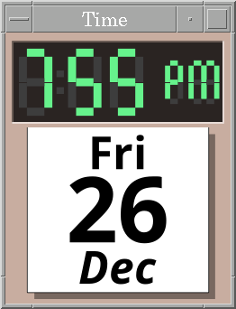
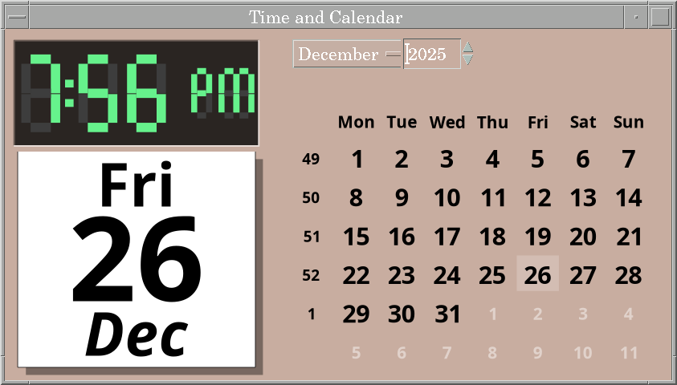
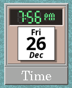

# Clock and Calendar (`ck-clock`)

`ck-clock` (`CkClock` X application class) combines a seven-segment digital LED display with a classic tear-off day calendar rendered via Cairo and styled from the active CDE/Motif color palette (`XmeGetColorObjData` / `XmGetColors`). Resizing the window wider automatically reveals an interactive monthly calendar with ISO week numbers.

| Simple view (`Time`) | Extended split view (`Time and Calendar`) |
| --- | --- |
|  |  |

## Responsive window views

`ck-clock` switches layout automatically based on its aspect ratio (`width` vs. `1.4 × height`):

- **Single-pane view (`width <= 1.4 × height`, window title `Time`):**
  - Upper sunken LED bar showing `HH:MM` (with an even-second blinking colon and locale-driven `AM`/`PM` indicator when `strftime("%p")` is non-empty).
  - Lower paper calendar tile showing localized abbreviated weekday, day of month, and month (`nl_langinfo`).
- **Extended split view (`width > 1.4 × height`, window title `Time and Calendar`):**
  - Keeps the LED and tear-off tile on the left and opens a full **8 × 7** monthly calendar grid on the right (leftmost ISO week-number column plus 7 weekday columns ordered by `_NL_TIME_FIRST_WEEKDAY`, dimmed adjacent-month days, and a highlighted current day).
  - Displays a localized **Month** selector (`XmOptionMenu`) and **Year** spinner (`XmSpinBox`, `1900`–`2200`). If left on the current month, the grid advances automatically at midnight across month boundaries.

## Dynamic desktop icon

`ck-clock` queries `WM_ICON_SIZE` from `dtwm` and renders size-adapted Cairo icon pixmaps (`IconPixmapHint`):

- **`32×32` and `48×48` (normal icon sizes):** Uses a crisp non-blurred `3×5` pixel-digital time band above a side-by-side day and stacked weekday/month layout.
- **`64×64` and `96×96` (increased icon sizes):** Uses the full vertical calendar tile, switching to the seven-segment LED display at `96×96`.
- **Update cadence:** Refreshes every minute while the normal window is open (supporting CK Core CDE's **Show Icons for Open Windows** mode) and every second while minimized (`IconicState`).



See [High-resolution dynamic icons](../dynamic-icons.md) for `32×32`–`96×96` comparisons across display densities.

## Command-line options

```sh
ck-clock [--no-embedd] [--locale <locale>] [--locale-debug] [Xt options...]
```

| Option | Effect |
| --- | --- |
| `--no-embedd` | Sets `WM_CLASS` to `ck-clock-debug` / `CKClockDebug` instead of `ck-clock` / `CKClock` to test standalone window behavior without matching CDE Front Panel swallow rules. |
| `--locale <loc>` / `--locale=<loc>` | Overrides `LC_TIME` (probing UTF-8 spelling variants) for weekday, month, first-weekday, and 12/24-hour formatting. |
| `--locale-debug` | Prints `LC_ALL`, `LC_TIME`, `LANG`, resolved `setlocale` state, and localized sample labels to `stderr`. |

## Dependencies and notes

- `ck-clock` links directly against Motif, Xt, X11, and Cairo (`-lcairo -lXm -lXt -lX11 -lm`) without requiring `-lDtSvc`, keeping startup lightweight for panel or companion use.
- Window geometry is controlled via standard X11/Xt `-geometry` resources rather than `-session` files.
