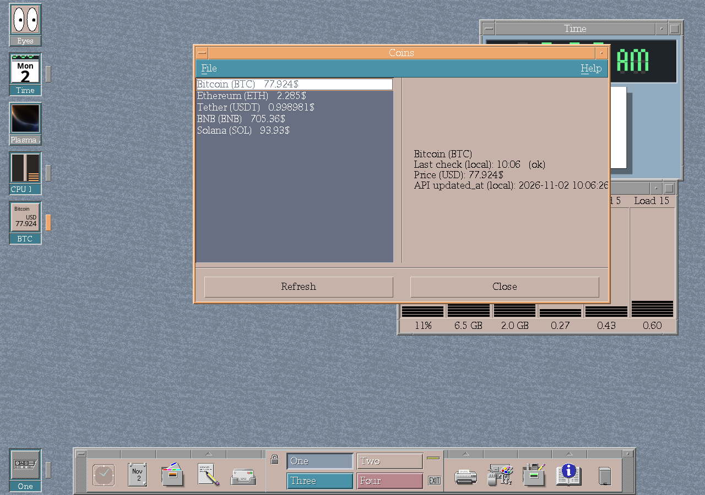

# Coins (`ck-coins`)

`ck-coins` (`CkCoins` X application class) tracks USD spot prices for selected cryptocurrencies via the public CoinGecko REST API and publishes the currently selected asset's symbol and live price onto its X11 desktop icon using anti-aliased `Xft` typography.



## Main window and menus

- **Coin list (left pane):** Displays tracked coins with their latest formatted USD price (`bitcoin` BTC, `ethereum` ETH, `tether` USDT, `binancecoin` BNB, and `solana` SOL by default). Selecting any row updates both the right-hand detail summary and the desktop window icon immediately.
- **Detail summary (right pane):** Reports `<Name> (<Symbol>)`, local check time and status (`ok` / `fail`), formatted USD price, and the upstream `last_updated_at` timestamp in local time.
- **Controls & menus:**
  - **Refresh** button: Triggers an immediate price check.
  - **File → New Window**: Spawns an additional `ck-coins` window (so multiple coins can be pinned as separate live desktop icons simultaneously).
  - **File → Exit** (`Alt+F4`) / **Close** button: Saves session state and exits.
  - **Help → About**: Opens the standard tabbed About dialog.

## Multi-instance cache and API behavior

To avoid rate-limiting when several `ck-coins` windows are open simultaneously:

- **Endpoint:** Queries `https://api.coingecko.com/api/v3/simple/price` over HTTPS via `libcurl` (`5 s` connect timeout, `10 s` total timeout, gzip/deflate enabled) every **15 minutes**.
- **Shared lock-protected cache:** Stores responses under `$XDG_CACHE_HOME/ck-coins/` (default `~/.cache/ck-coins/`) in `cache-<hash>.json` coordinated with `flock()` (`LOCK_SH` / `LOCK_EX`) and a `900 s` (15-minute) TTL.

## Responsive Xft dynamic icon

`ck-coins` renders its `WM_ICON_SIZE` pixmap with `Xft` (`Sans` / `DejaVu Sans`) both while minimized and while open:

- **`32×32`:** Compact two-row layout (`<SYMBOL>/USD` above the price) so labels never overlap at small icon sizes.
- **`48×48`, `64×64`, and `96×96`:** Three-band layout (coin name top-left, `USD` middle-right, price bottom-right) with automatic font-size fitting; text renders in black after a successful refresh or muted gray (`gray60`) if the last fetch failed.

See [High-resolution dynamic icons](../dynamic-icons.md) for all four icon sizes.

## Command-line options, environment, and session state

```sh
CK_COINS_IDS="bitcoin,ethereum,cardano" ck-coins [-session <session_id>] [Xt options...]
```

| Setting | Purpose |
| --- | --- |
| `-session <id>` | Restores CDE session geometry (`x`, `y`, `w`, `h`) and the selected coin row (`selected_index`). |
| `CK_COINS_IDS` | Comma-separated CoinGecko asset IDs overriding the five built-in default coins. |
| `CK_COINS_DEBUG_ICON` | Non-empty value logs `Xft` slot and font-fitting metrics to `stdout`. |

## Notes and limitations

- Network requests execute synchronously via `curl_easy_perform` on the UI thread when the 15-minute disk cache has expired (bounded by the 10-second `libcurl` timeout).
