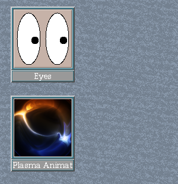
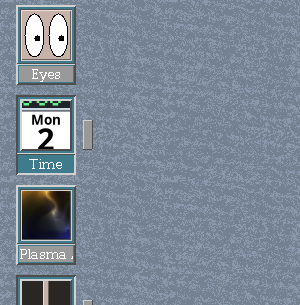

# Eyes (`ck-eyes`)

`ck-eyes` (`CkEyes` X application class) is a native Motif/CDE pointer-tracking companion inspired by classic `xeyes`. When minimized on CK Core CDE, it continues tracking the X11 pointer directly inside its shaped desktop icon.

## Interaction and styles

- **Toggle drawing style:** Click any mouse button inside the `ck-eyes` window to switch between its two geometries:
  1. **Elliptical style (default, `eye_style = 1`):** Tall, full-height elliptical eyes with proportionally scaled outline thickness.
  2. **Circular style (`eye_style = 0`):** Side-by-side circular eyes centered vertically in the window.
- **Smooth tracking:** Samples pointer coordinates via `XQueryPointer` every `50 ms` (`20 FPS`).

## Shaped dynamic icon

`ck-eyes` switches rendering targets automatically based on window state:

- **Open & viewable:** Redraws only the main `XmDrawingArea` (`200×120` default), avoiding unnecessary icon pixmap allocations.
- **Minimized / unmapped (`IconicState`):** Renders both a `WM_ICON_SIZE`-matched `IconPixmapHint` and a **1-bit `IconMaskHint`** shape mask so the desktop backdrop shows cleanly around the pair of eyes.
- **Icon-relative gaze:** Resolves the icon's on-screen coordinates from `_NET_WM_ICON_GEOMETRY` or `IconWindowHint` (`XTranslateCoordinates`) when available so the pupils point accurately toward the cursor from the icon's actual desktop position (falling back to screen-proportional mapping otherwise).

| Motion frame A | Motion frame B (4 seconds later) |
| --- | --- |
|  |  |

See [High-resolution dynamic icons](../dynamic-icons.md) for `32×32`–`96×96` icon captures.

## Command-line options and session state

```sh
ck-eyes [-session <session_id>] [Xt options...]
```

- **CDE session state:** Saves and restores window geometry (`x`, `y`, `w`, `h`) and the selected `eye_style` (`0` or `1`) across CDE sessions via `DtSessionSavePath` / `DtSessionRestorePath`.
