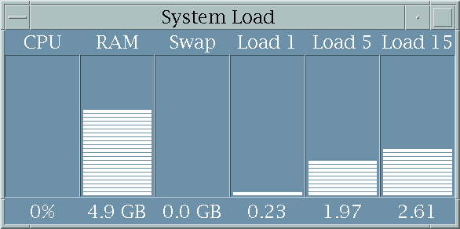
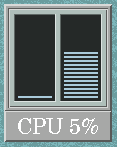

# System Load (`ck-load`)

`ck-load` (`LoadMeters` X application class, window title **System Load**) monitors real-time Linux CPU utilization, physical memory, swap usage, and 1-, 5-, and 15-minute load averages using six segmented 3D Motif meters (`VerticalMeter`).

| Main window | Live desktop icon |
| --- | --- |
|  |  |

## Monitored metrics

Updated once per second (`1000 ms`) from Linux `/proc`:

| Column | Source | Readout format | Scaling behavior |
| --- | --- | --- | --- |
| **CPU** | `/proc/stat` (`user`, `nice`, `system`, `idle`, `iowait`, `irq`, `softirq`, `steal` deltas) | `<N>%` | `0`–`100%` |
| **RAM** | `/proc/meminfo` (`MemTotal - MemAvailable`) | `<X.Y> GB` | `0`–`MemTotal` |
| **Swap** | `/proc/meminfo` (`SwapTotal - SwapFree`) | `<X.Y> GB` | `0`–`SwapTotal` |
| **Load 1 / 5 / 15** | `/proc/loadavg` normalized by `sysconf(_SC_NPROCESSORS_ONLN)` | Raw load (`0.00`) | `1.0` per online CPU core = `100%`; if any load exceeds `100%`, all three load meters scale together and draw cells above `100%` as outlined segments |

## Dynamic icon and sticky label geometry

`ck-load` integrates closely with CK Core CDE's `dtwm` window manager (`<Dt/WmSettings.h>`):

- **On-demand rendering:** Tracks both `WM_STATE` (`IconicState`) and `_DT_WM_SETTINGS_V1` (`DT_WM_SETTINGS_V1_SHOW_OPEN_WINDOW_ICONS`), rendering its dual-bar **CPU / RAM** icon pixmap only when the window is minimized or open-window desktop icons are enabled.
- **Responsive sizing:** Queries `WM_ICON_SIZE` (`32×32`, `48×48`, `64×64`, `96×96`) and adjusts bar contrast automatically against the current Motif palette.
- **Non-jittering icon label (`icon_label_state.c`):** Measures `"CPU <N>%"` in the actual Motif label font against the icon width. If a wider value (such as `CPU 100%`) overflows a narrow icon (`32×32`), `ck-load` latches to compact `<N>%` labels and keeps that form until `dtwm` advertises a new icon size—verified by unit test `tests/ck_load_icon_label_state_test.c` (`make check`).

See [High-resolution dynamic icons](../dynamic-icons.md) for rendered icon comparisons.

## Command-line options and session state

```sh
ck-load [-session <session_id>] [Xt options...]
```

- **CDE session state:** Saves and restores window position and dimensions (`x`, `y`, `w`, `h`) via `DtSessionSavePath` / `DtSessionRestorePath`.
