# High-resolution dynamic icons

CK Core Apps can publish a newly rendered `WM_HINTS` icon pixmap whenever
application state changes. CK Core CDE's open-window icon mode keeps that
client-supplied image visible on the desktop while the normal window is open,
and its larger icon-size setting gives the live view enough space to remain
legible.

This is an X11 window-icon contract, not a separate widget layer or a Front
Panel embedding mechanism. The owning application renders the pixels; dtwm
places and refreshes the icon.

## Implemented applications

| Application | Live icon content | Update trigger |
| --- | --- | --- |
| `ck-clock` | Analog clock face | Minute change and icon-state refresh, including open-window icons |
| `ck-load` | CPU and RAM bars | Every second, including open-window icons |
| `ck-eyes` | Eyes and pupils following the pointer | Every 50 ms while minimized |
| `ck-browser` | Favicon of the active browser tab | Active tab or page favicon change, including open-window icons |
| `ck-coins` | Selected coin symbol and price | Selection and market-data refresh, including open-window icons |
| `ck-plasma-1` | Animated plasma frame | Each generated frame while minimized |

`ck-clock`, `ck-load`, `ck-eyes`, `ck-browser` and `ck-coins` are user-facing
applications. `ck-plasma-1` is a demo of the same update contract.

Eyes and Plasma render their compact path when the client enters the minimized
state. Clock, Load, Browser and Coins update their icon pixmaps while their
normal windows remain open, so CK Core CDE's open-window icons can act as live
desktop views without minimizing those applications.

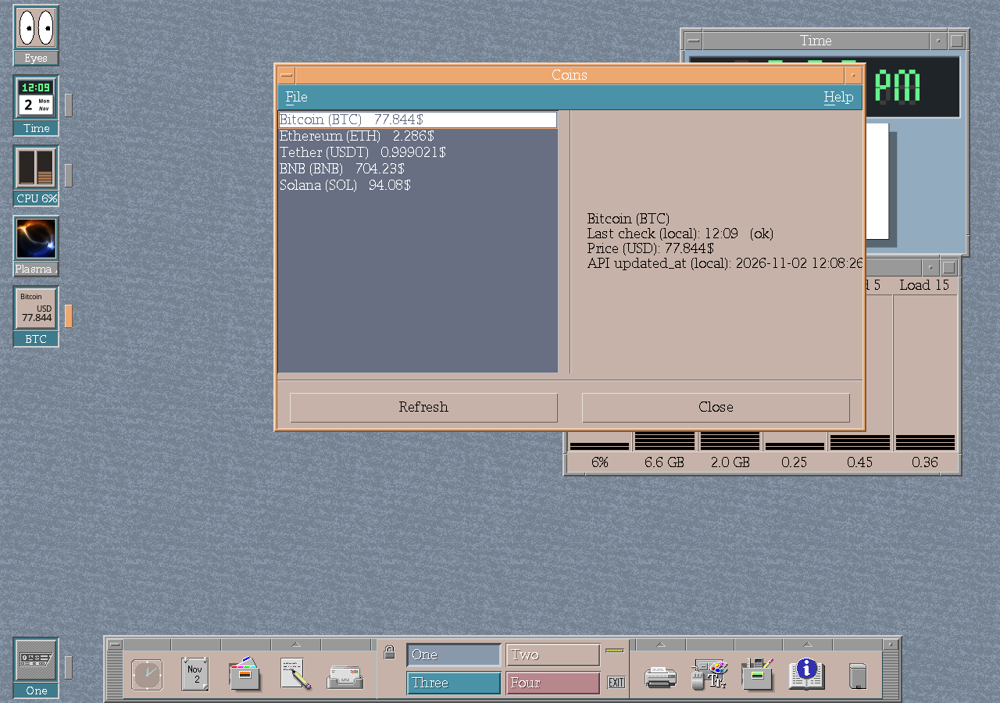

*A fresh uConsole smoke session running CK Core CDE, CK Core Motif ABI 9 and
five CK Core Apps. Eyes and Plasma are minimized; Clock, System Load and Coins
continue updating their desktop icons while their normal windows are open.*

### Motion in the minimized icon path

The two frames below were captured four seconds apart after moving the pointer.
They show that Eyes redraws its pupils and Plasma publishes a new animation
frame through the minimized-window icon path.

| Earlier frame | Later frame |
| --- | --- |
| 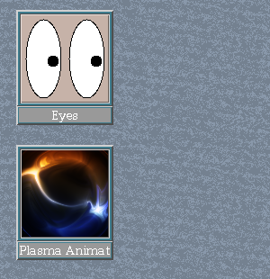 | 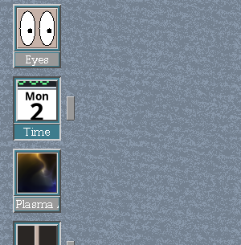 |

## Normal and increased icon sizes

Style Manager's **Increase Icon Size** setting doubles dtwm's advertised icon
geometry. CDE uses a 32×32 / 64×64 pair on low-resolution displays and a
48×48 / 96×96 pair on higher-resolution displays. Each app queries
`WM_ICON_SIZE` and renders a new pixmap for the selected geometry; dtwm does not
crop a fixed-size source image.

Clock uses two responsive arrangements. At 32×32 and 48×48, its readable
pixel-digital time occupies the upper band while the date sits beside stacked
weekday and month labels. At 64×64 and 96×96, it follows the full vertical
calendar design; 96×96 uses the larger seven-segment time display.

System Load keeps its icon label stable as the percentage changes. If the full
`CPU N%` form becomes too wide, that icon-size setting switches to `N%` and
keeps the compact form until CDE advertises a different icon geometry.

### Low-resolution CDE pair

| Application | Normal, 32×32 | Increased, 64×64 |
| --- | --- | --- |
| System Load | 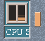 | 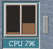 |
| Clock | 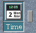 | 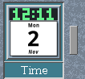 |
| Eyes | 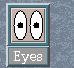 | 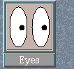 |
| Plasma | 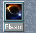 | 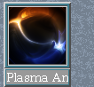 |
| Coins | 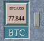 | 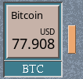 |
| Browser |  |  |

### Higher-resolution CDE pair

| Application | Normal, 48×48 | Increased, 96×96 |
| --- | --- | --- |
| System Load |  | 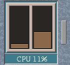 |
| Clock | 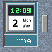 | 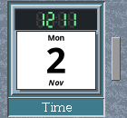 |
| Eyes | 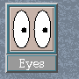 | 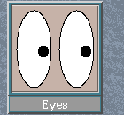 |
| Plasma | 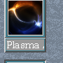 | 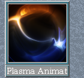 |
| Coins | 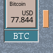 | 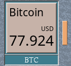 |
| Browser |  | 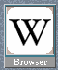 |

These screenshots come from four separate uConsole smoke sessions. Their root
`WM_ICON_SIZE` properties reported 32×32, 48×48, 64×64 and 96×96 respectively,
and every captured process resolved CK Core Motif `libXm.so.9` from the same
toolkit cohort as CDE.

The Browser row shows the favicon of its active Wikipedia tab. Changing tabs
updates the same desktop icon to the newly active site's favicon.

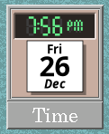

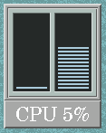

## CDE settings

In CK Core CDE, enable **Show Icons for Open Windows** and select the larger
window-icon size in Style Manager. The corresponding dtwm resource is
`Dtwm*showOpenWindowIcons`.

The implementation uses the icon geometry advertised by dtwm when available,
then publishes `IconPixmapHint` and, where needed, `IconMaskHint`. This keeps
the apps independent of dtwm internals while allowing CK Core CDE to present
their high-resolution output.

See [Window-aware desktop icons](https://cklukas.github.io/ck-core-cde/improvements/window-state.html)
for the window-manager side of the feature.
