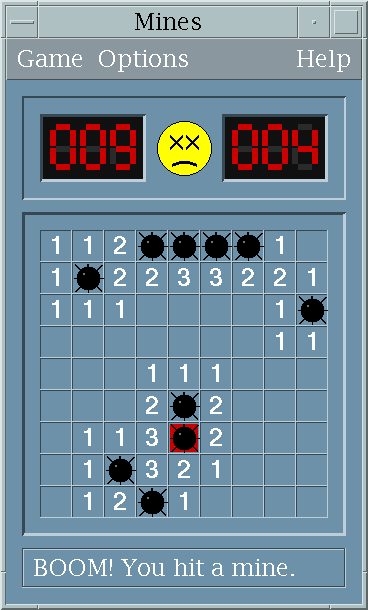

# Mines (`ck-mines`)

`ck-mines` (`ck-mines` X application class, window title **Mines**) is a native Motif/CDE Minesweeper implementation featuring custom seven-segment mine and elapsed-time LED counters, an interactive smiley reset button, guaranteed safe first click, two-button chording, DPI-aware board scaling, and a persistent high-score table.

## Difficulty presets and board scaling

Select a preset from the **Game** menu or adjust board scale under **Options**:

| Preset | Grid (`cols × rows`) | Mines |
| --- | --- | --- |
| **Game → Beginner** | `9 × 9` | `10` |
| **Game → Intermediate** | `16 × 16` | `40` |
| **Game → Expert** | `30 × 16` | `99` |

- **Options → Enable Question Marks:** Cycles right-click cell marks through `Flag → ? → Clear` instead of `Flag ↔ Clear`.
- **Options → Default Size / Large Size:** Selects `1×` or `2×` board rendering on top of automatic X11 screen-DPI scaling (`1.0`–`4.0`).

## Mouse controls

- **Left-click (`Button1`):** Reveals a covered cell (flood-filling zero-mine regions). Mines are placed on the first click so the opening move is never a mine.
- **Right-click (`Button3`):** Places or removes a mine flag (and optional `?` mark).
- **Chording (`Button1 + Button3`):** Releasing while pressing both buttons on a revealed number cell whose adjacent flags match its count reveals all remaining unflagged neighbors at once.
- **Smiley button:** Starts a fresh board at the current difficulty.

## Configuration and fastest times

- **Fastest Mine Sweepers:** Winning Beginner, Intermediate, or Expert in record time prompts for a player name; inspect or clear records at any time from **Game → Fastest Mine Sweepers...**.
- **Configuration file:** `$XDG_CONFIG_HOME/ck-core/ck-mines.conf` (default `~/.config/ck-core/ck-mines.conf`, with legacy fallback `~/.ck-minesrc`) stores `diff`, `cols` (`8`–`60`), `rows` (`8`–`40`), `mines`, `marks`, `large_scale`, and the best times and player names for each preset. *(Setting `diff=3` in `ck-mines.conf` also loads custom `cols`, `rows`, and `mines` dimensions.)*

## Environment variables

| Variable | Effect |
| --- | --- |
| `CK_MINES_SCALE` | Float (`0.5`–`4.0`) overriding automatic X11 DPI cell scaling. |
| `CK_MINES_BACKBUF` | Non-empty value enables offscreen X11 `Pixmap` double-buffering for board redraws. |
| `CK_MINES_DEBUG` | Verbosity level `0`–`3` (default `1`; set `0` to silence `[ck-mines]` diagnostic lines on `stderr`). |
