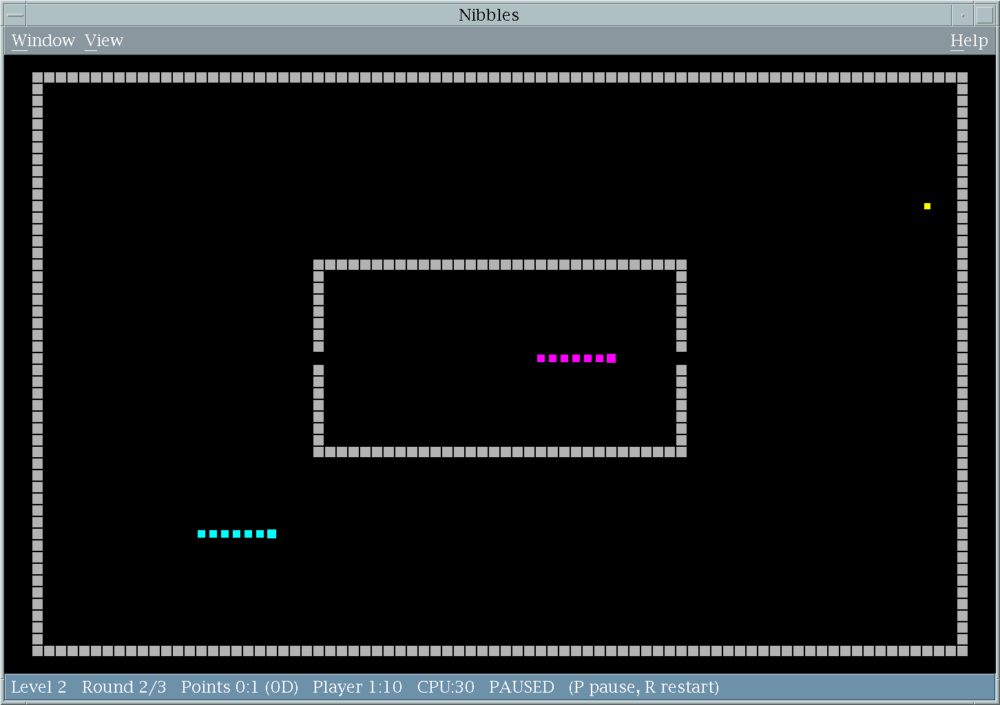

# Nibbles (`ck-nibbles`)

`ck-nibbles` (`CkNibbles` X application class, window title **Nibbles**) is a retro QBasic-inspired snake game rendered on an `80 × 50` grid (`90 ms` tick interval) with single-player vs. CPU and local two-player modes, cycling maze layouts, multi-round match tracking, and automatic focus-loss pause.



## Game modes and rules

Opening `ck-nibbles` (or choosing **Window → New Game...**) presents the match setup dialog:

- **1 — You vs CPU:** Plays against a Manhattan-distance greedy AI snake.
- **2 — Two Players:** Local head-to-head play on the shared keyboard (can also be preselected with `-2` / `--two` on the command line).
- **Rounds (`1`–`99`):** Plays a multi-round series across six distinct wall-maze patterns (`level % 6`), advancing levels after each round.
- **Scoring & collisions:** Collecting food adds `+10` points and `+2` segments; crashing into a wall, boundary, or snake deducts `-25` points, awards `+1` round point to the survivor (or `+1` to both snakes on a simultaneous head-on draw), and displays the exact collision summary.
- **View → Show Grid:** Toggles subtle cell grid lines across the playfield; resizing the window scales cell pixel dimensions dynamically (`>= 6 px` per cell).

## Keyboard controls

`ck-nibbles` suppresses X11 key auto-repeat and buffers rapid turns through a 32-entry per-snake direction queue (ignoring instant 180-degree self-reversals):

| Key(s) | Action |
| --- | --- |
| `Up`, `Down`, `Left`, `Right` | **Player 1** direction |
| `W`, `A`, `S`, `D` | **Player 2** direction (Two-Player mode) |
| `P` | Pause / resume |
| `R` | Restart the current round |
| `Alt+F4` | **Window → Close** |

Leaving the window (`FocusOut`) pauses the round automatically and resumes on `FocusIn`.

## Command-line options and session state

```sh
ck-nibbles [-2 | --2 | --two] [-session <session_id>] [Xt options...]
```

- **CDE session state:** Saves and restores window geometry (`x`, `y`, `w`, `h`), `show_grid`, player mode and names, round counters, level, and match scores via `DtSessionSavePath` / `DtSessionRestorePath`, restoring into a paused round without re-opening the setup dialog.
