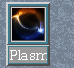
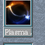
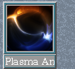
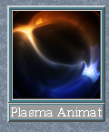
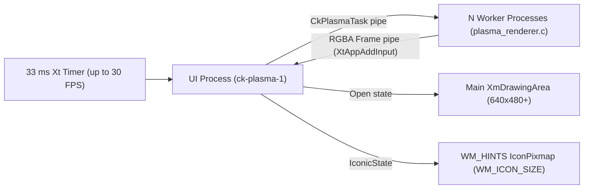

# Plasma Demo (`ck-plasma-1`)

`ck-plasma-1` (`CkPlasma` X application class, window title **Plasma Animation**) is a multi-process real-time mathematical plasma animation demo that exercises parallel CPU frame rendering over POSIX pipes and CK Core CDE's live minimized desktop icon path.

| `32×32` icon | `48×48` icon | `64×64` icon | `96×96` icon |
| --- | --- | --- | --- |
|  |  |  |  |

## Multi-process rendering pipeline

At startup, `ck-plasma-1` queries `sysconf(_SC_NPROCESSORS_ONLN)` and forks one worker process per online CPU core:



- **Non-blocking UI loop:** Worker result pipes register with `XtAppAddInput` (`XtInputReadMask`). Completed frames are reordered by `frame_index`, bounded to at most two in-flight frames (`CK_PLASMA_MAX_PENDING = 2`), and tagged with a monotonically increasing `generation` counter so resize or minimize transitions immediately discard stale frames.
- **Seam-free 240-frame sequences:** `plasma_renderer.c` evaluates an 8-iteration trigonometric/hyperbolic-tangent field over a 240-step cycle, modulating sequence parameters with a `0.5 * (1 - cos(t))` envelope so transitions between 240-frame variations have zero visual seam.
- **Mutually exclusive window vs. icon rendering:** While viewable, workers render at the `XmDrawingArea` dimensions; when minimized (`IconicState`), `ck-plasma-1` switches worker tasks to `dtwm`'s advertised `WM_ICON_SIZE` (`32×32`–`96×96`) and publishes live `IconPixmapHint` frames at up to 30 FPS.

See [High-resolution dynamic icons](../dynamic-icons.md#motion-in-the-minimized-icon-path) for sequential motion captures.

## Command-line options and session state

```sh
ck-plasma-1 [-session <session_id>] [Xt options...]
```

- **CDE session state:** Saves and restores window geometry (`x`, `y`, `w`, `h`) via `DtSessionSavePath` / `DtSessionRestorePath`.
