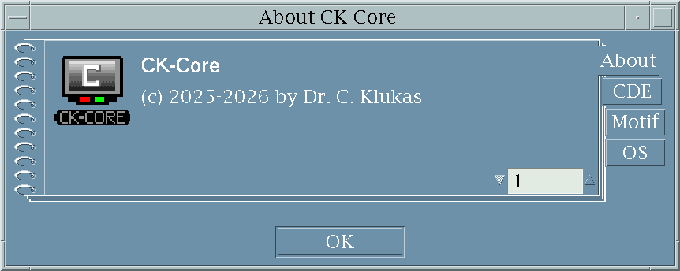

# About CK-Core (`ck-about`)

`ck-about` (`CkAbout` X application class, window title **About CK-Core**) is a standalone desktop information utility built on `XmNotebook`. It reports version and platform metadata for CK-Core, CDE, CK Core Motif, and the host operating system. The same shared implementation (`src/shared/about_dialog.c`) drives the **Help → About** dialogs across the rest of the CK Core Apps suite.



## Notebook tabs

| Tab | Reported fields | Source |
| --- | --- | --- |
| **About** | CK-Core logo (DPI-scaled `1x`–`4x` from `96 DPI`), title, and copyright | Compiled XPM asset (`src/shared/ck-core.l.pm`) |
| **CDE** | `Version`, `Major / Revision / Update`, `Version Number` | `<Dt/Dt.h>` (`DtVERSION_STRING`, `DtVERSION`, `DtREVISION`, `DtUPDATE_LEVEL`, `DtVERSION_NUMBER`) |
| **Motif** | `Version`, toolkit description, and LGPL v2.1 license summary | `<Xm/Xm.h>` (`XmVERSION_STRING`) |
| **OS** | `Distributor ID`, `Description`, `Release`, `Codename` | `lsb_release -i/-d/-r/-c -s` (falls back to `n/a` when `lsb_release` is not installed) |

## Controls and keyboard navigation

- **`Return` / `Enter`:** Activates the default **OK** button and closes `ck-about`.
- **Tab traversal:** Standard Motif keyboard navigation switches between notebook tabs and the **OK** button.
- **Initial placement:** Centers itself on the default X11 screen (`400`–`850 px` width, minimum `300 px` height) when launched without prior session geometry.

## Command-line options and session state

```sh
ck-about [-session <session_id>] [Xt options...]
```

- **CDE session state:** Handles `WM_SAVE_YOURSELF` via `DtSessionSavePath` / `DtSessionRestorePath`, preserving window geometry (`x`, `y`, `w`, `h`) and the active 1-based notebook tab (`page`) across CDE logout and login.
