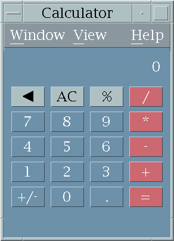

# Calculator (`ck-calc`)

`ck-calc` (`CkCalc` X application class) is a native Motif/CDE desktop calculator providing both a classic **Basic** immediate-execution keypad and a **Scientific** expression-evaluation layout, styled automatically from the active CDE color palette.



## Modes and layout

Switch modes from **View → Basic** or **View → Scientific**:

| Mode | Grid | Evaluation model | Window width |
| --- | --- | --- | --- |
| **Basic** | 4 × 5 | Immediate arithmetic (`+`, `-`, `*`, `/`, `%`, `+/-`) | `280 px` |
| **Scientific** | 10 × 5 | Parenthesized formula evaluator with memory, powers, roots, logarithms, factorials, constants, and trigonometry | `640 px` |

- **Palette integration:** Operator buttons (`/`, `*`, `-`, `+`, `=`) and top utility keys (`<`, `AC`, `%`) read the active CDE `ColorObj` color sets (`src/shared/cde_palette.c`) so keypad contrast tracks the current CDE Style Manager palette.
- **Thousands separators:** Toggle **View → Show thousands separators** to group integer digits according to the active locale.
- **Angle units (Scientific mode):** An indicator bar beneath the display highlights the active unit (`Rad`, `Deg`, `Grad`, or `Turn`), cycled with the keypad's angle button.
- **Shift / `2nd` functions (Scientific mode):** Toggle the `2nd` key—or hold `Shift` on the keyboard—to switch trigonometric and logarithmic keys to their inverse/alternate forms (`sin⁻¹`, `cos⁻¹`, `tan⁻¹`, `sinh⁻¹`, `cosh⁻¹`, `tanh⁻¹`).

## Menus and clipboard

| Menu / Control | Action | Shortcut |
| --- | --- | --- |
| **Window → New** | Spawn an independent `ck-calc` window | `Ctrl+N` |
| **Window → Close** | Save view/session state and close the window | `Alt+F4` |
| **View → Show thousands separators** | Toggle grouped digit formatting | — |
| **View → Basic / Scientific** | Switch keypad layout and evaluation mode | — |
| **Help → About** | Open the tabbed About dialog | — |
| **Display right-click (`Button3`)** | Open popup menu with **Copy** and **Paste** (flashes `COPIED` / `PASTED` briefly) | — |

## Keyboard input

`ck-calc` routes keyboard events through an internal focus proxy so numeric entry works regardless of which button last had focus:

- **Digits:** `0`–`9` and numeric keypad `KP_0`–`KP_9` (including un-NumLocked keypad navigation keys).
- **Operators:** `+`, `-`, `*`, `/`, `%` (and keypad equivalents).
- **Decimal separator:** Locale decimal character (`.` or `,`) and `KP_Decimal`.
- **Evaluate:** `=`, `Return`, or `KP_Enter`.
- **Backspace:** `BackSpace`, `Delete`, or `KP_Delete` (`<`).
- **All Clear (`AC`):** `A` or `C` (case-insensitive).
- **Temporary `2nd` modifier:** Hold `Shift_L` or `Shift_R` in Scientific mode.

> [!NOTE]
> Because `C` triggers **AC** (All Clear) for classic desk-calculator typing, use the display's right-click context menu for **Copy** and **Paste** rather than `Ctrl+C`.

## Command-line options and persistence

```sh
ck-calc [-session <session_id>] [Xt options...]
```

- **User preferences:** Stored in `$XDG_CONFIG_HOME/ck-core/ck-calc.view` (default `~/.config/ck-core/ck-calc.view`), recording `show_thousands`, `mode`, and `trig_mode`.
- **CDE session state:** Responds to `WM_SAVE_YOURSELF` via `DtSessionSavePath` / `DtSessionRestorePath` (`src/shared/session_utils.c`), saving window position (`x`, `y`, `w`, `h`), the current `display` value, `show_thousands`, `mode`, and `trig_mode`.

## Current limitations

- Sign toggle (`+/-`) and percent (`%`) operate in **Basic** mode only; in **Scientific** mode use unary `-` and explicit division in expressions.
- Window dimensions are fixed to each mode's keypad metrics (maximize and manual resize decorations are disabled).
