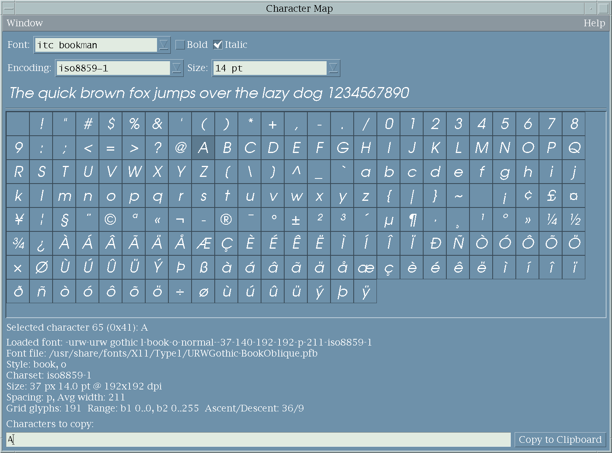

# Character Map (`ck-character-map`)

`ck-character-map` (`CkCharacterMap` X application class) browses server-side X11 core (XLFD) fonts and aliases, previews word-wrapped sample text, inspects glyph ranges and font path files, and copies selected characters to the X11/Motif clipboard.



## Interface overview

1. **Font & style bar:**
   - **Font:** Groups discovered X11 fonts by XLFD `foundry|family` (plus font aliases).
   - **Bold / Italic:** Toggle buttons that automatically enable or disable according to the styles available in the selected font family and encoding.
   - **Encoding:** Filters available character encodings for the chosen family (defaulting to `iso10646-1` when present).
   - **Size:** Lists discrete bitmap pixel sizes or scalable point sizes (`8`–`72 pt`, computed from screen DPI).
2. **Sample text preview:**
   - Renders word-wrapped sample text using the currently loaded X11 font.
   - Click anywhere inside the preview box to open the **Sample Text** prompt dialog (`OK`, `Cancel`, or `Default` to restore `"The quick brown fox jumps over the lazy dog 1234567890"`).
3. **Scrollable glyph grid:**
   - Displays all populated 1-byte or 2-byte glyphs in the loaded font and automatically reflows its column count when the window is resized.
   - Clicking any cell highlights the glyph, displays its decimal and hexadecimal code point (`Selected character <code> (0x<HEX>)`), and appends the character to **Characters to copy**.
4. **Font metadata & clipboard panel:**
   - Displays clickable metadata rows (`Loaded font`, `Font file` resolved from `fonts.dir` / `fonts.scale` / `fonts.alias` along `XGetFontPath`, `Style`, `Charset`, `Size`, `Spacing`, and glyph/ascent/descent metrics). Clicking any metadata line copies that property value into the text field.
   - **Copy to Clipboard** publishes the accumulated text in both `UTF8_STRING` and `STRING` clipboard formats via `XmClipboardCopy`.

## Menus and shortcuts

| Action | Shortcut |
| --- | --- |
| **Window → New** (open a second Character Map window) | `Ctrl+N` |
| **Window → Close** | `Alt+F4` |
| **Help → About** | — |

## Command-line options and session state

```sh
ck-character-map [-session <session_id>] [Xt options...]
```

- **CDE session state:** Saves and restores window geometry (`x`, `y`, `w`, `h`), selected font group (`group_key`), encoding (`encoding_key`), `bold` and `italic` states, and size (`pixel_size`, `point_deci`) via `DtSessionSavePath` / `DtSessionRestorePath`.
- No standalone file under `~/.config/ck-core/` is written outside CDE session management.

## Notes and limitations

- `ck-character-map` queries the X server's core font catalogue (`XListFonts`, `XLoadQueryFont`, `XGetFontPath`). Client-side Fontconfig/Xft fonts that are not registered in an X11 font path directory do not appear in the list.
- Copying glyphs to UTF-8 maps raw glyph indices directly (`iso10646-1` and `iso8859-1` map one-to-one to Unicode; legacy vendor-specific 8-bit/16-bit encodings emit raw code indices without iconv transcoding).
