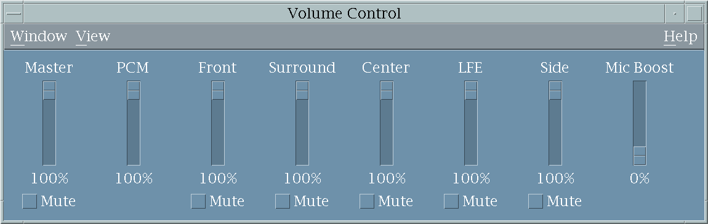

# Volume Control (`ck-mixer`)

`ck-mixer` (`CkMixer` X application class, window title **Volume Control**) is a classic multi-column Motif frontend for ALSA mixer devices (`libasound`), providing vertical playback sliders, mute toggles, live external-change tracking, and per-channel column filtering.



## Features and controls

- **ALSA device selector:** Enumerates available ALSA control (`ctl`) devices via `snd_device_name_hint` (excluding `null`) in a collapsible top drop-down bar.
- **Per-element mixer columns:** Creates a vertical `0`–`100%` slider (`XmScale`), numeric percentage readout, and **Mute** toggle (`XmToggleButton` when `snd_mixer_selem_has_playback_switch` is present) for each active playback volume element on the selected card.
- **Live event synchronization:** Registers ALSA mixer poll descriptors (`snd_mixer_poll_descriptors`) directly with the Xt event loop (`XtAppAddInput`) so volume or mute changes made by hardware keys or other audio tools update the sliders immediately.
- **Column filtering:** Under the **View** menu, toggle **Show device selector** to collapse the top bar, or check/uncheck individual mixer element names to show only the channels you use.

## Menus and shortcuts

| Menu item | Description | Shortcut |
| --- | --- | --- |
| **Window → Close** | Save preferences and exit | `Alt+F4` |
| **View → Show device selector** | Show or hide the ALSA card selector bar | `Alt+V`, `S` |
| **View → `<Control Name>`** | Show or hide individual playback columns | — |
| **Help → About Mixer** | Open the standard tabbed About dialog | — |

## Command-line options and persistence

```sh
ck-mixer [-session <session_id>] [Xt options...]
```

- **User configuration:** `$XDG_CONFIG_HOME/ck-core/ck-mixer.view` (default `~/.config/ck-core/ck-mixer.view`) stores `show_device_combo` (`0` or `1`) and per-control visibility flags (control names normalized with `_`).
- **Session geometry:** Captures `x`, `y`, `w`, `h`, `device_index`, and `show_device_combo` through `session_utils`.

## Notes and limitations

- Requires at least one active ALSA control device at startup; on headless machines without ALSA sound cards, `ck-mixer` exits with status `1`.
- Exposes playback volume elements (`snd_mixer_selem_has_playback_volume`) and sets playback levels uniformly across channels (`snd_mixer_selem_set_playback_volume_all`); capture/recording levels and independent left/right balance sliders are not exposed.
